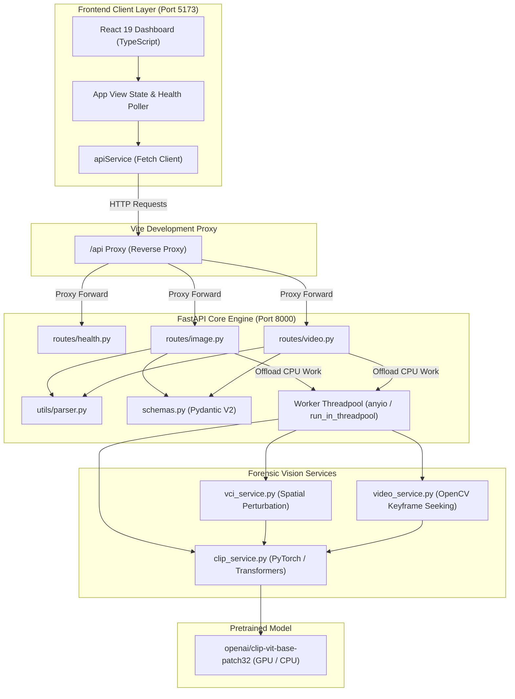

# System Architecture Documentation

**Project Title:** CrimeScene — CLIP-Based Video and Image Analysis with Visual Counterfactual Intelligence  
**Author:** CrimeScene Engineering Team  
**Revision:** 1.0.0  

---

## 1. Architectural Philosophy

CrimeScene is architected as an **asynchronous, modular, client-server forensic vision platform**. Deep neural network inference (OpenAI CLIP) and computer vision operations (OpenCV video frame extraction) are decoupled from the asynchronous request handling layer to ensure that the system remains responsive, scalable, and safe from event-loop starvation.



---

## 2. Backend Architecture (FastAPI & PyTorch)

### A. Lifespan Model Management
In traditional naive setups, machine learning models are loaded on every incoming request or lazily upon the first request, resulting in high latency spikes. CrimeScene utilizes FastAPI's `@asynccontextmanager lifespan`:
- At startup, `load_clip_model()` loads the weights of `openai/clip-vit-base-patch32` into memory once.
- Hardware acceleration (`CUDA`) is dynamically detected:
  ```python
  device = "cuda" if torch.cuda.is_available() else "cpu"
  ```
- The model is placed in evaluation mode (`model.eval()`) with inference mode (`torch.inference_mode()`) to minimize memory footprint and eliminate gradient computation overhead.

### B. Prevention of Event Loop Starvation
FastAPI is built on Starlette and `asyncio`. Running synchronous, CPU-intensive PyTorch forward passes or OpenCV video frame decoding directly inside an `async def` route blocks the entire Python process thread.

CrimeScene routes use `starlette.concurrency.run_in_threadpool`:
```python
# Video analysis offloaded to external worker threadpool
result = await run_in_threadpool(
    analyze_video,
    video_bytes=contents,
    file_extension=extension,
    descriptions=description_list,
    interval_seconds=interval_seconds,
    max_frames=max_frames
)
```
**Benefits:**
- The `asyncio` event loop continues processing concurrent I/O.
- Health checks (`GET /api/health`) respond in $<5\text{ms}$ even while an analysis is in progress.

### C. Resilient Input Parsing Layer
The parser (`backend/app/utils/parser.py`) normalizes multimodal inputs:
1. **JSON Arrays:** Parses valid JSON array strings.
2. **Python String Literals:** Parses single-quoted Python lists via safe `ast.literal_eval`.
3. **Newline Separation:** Treats multiline input as distinct hypotheses.
4. **Natural-Language Sentences with Commas:** Uses participle and conjunction regex heuristics (`^[a-z]{2,}(?:ing|ed)\b`) to ensure sentences like *"a man in a black jacket, holding a knife"* are preserved as one complete sentence rather than fragmented.
5. **Comma-Separated Keywords:** Splits lists of distinct entities into individual candidate queries.

---

## 3. Service Layer Design

### 1. `clip_service.py`
- Prepares normalized L2 embeddings:
  $$\hat{\mathbf{e}}_{\text{img}} = \frac{\mathbf{e}_{\text{img}}}{\|\mathbf{e}_{\text{img}}\|_2}, \quad \hat{\mathbf{e}}_{\text{txt}} = \frac{\mathbf{e}_{\text{txt}}}{\|\mathbf{e}_{\text{txt}}\|_2}$$
- Computes cosine similarity via matrix dot product:
  $$S = \hat{\mathbf{e}}_{\text{img}} \cdot \hat{\mathbf{e}}_{\text{txt}}^\top$$
- Sorts results descending by similarity score.

### 2. `vci_service.py`
- Implements Visual Counterfactual Intelligence through spatial occlusions.
- Calculates unperturbed baseline score $S_0$.
- Divides image into $N \times N$ patches ($N \in [2, 8]$).
- Occludes each patch with neutral grey `(128, 128, 128)`.
- Calculates sensitivity delta: $\Delta = S_0 - S_{\text{masked}}$.

### 3. `video_service.py`
- Uses OpenCV direct timestamp seeking (`cv2.CAP_PROP_POS_FRAMES`) to jump directly to sampled timestamps ($t_i = i \times \text{interval}$).
- Avoids decoding intermediary unneeded frames, reducing decoding time from minutes to seconds.
- Converts sampled frames to PIL Images and generates lightweight base64 JPEG thumbnails ($\sim 8-15\text{ KB}$ each) embedded directly into the response payload.

---

## 4. Frontend Architecture (React 19 + TypeScript)

```text
frontend/src/
├── components/          # Self-contained view components
│   ├── Header.tsx       # Top bar with live polling health badge
│   ├── Dashboard.tsx    # Landing overview & system metrics
│   ├── ImageAnalysis.tsx# Image evidence uploader & similarity bars
│   ├── VCIAnalysis.tsx  # Interactive canvas/grid heatmap overlay
│   ├── VideoAnalysis.tsx# Timeline scrubber with frame thumbnails
│   └── Methodology.tsx  # Scientific principles & forensic limits
├── services/
│   └── api.ts           # Centralized API service (Fetch API)
├── styles/
│   └── components.css   # Modular glassmorphism UI styles
├── types/
│   └── api.ts           # Strict TypeScript contracts (Zero 'any')
├── App.tsx              # Root router & health interval
├── App.css              # Container layout & responsive grid
└── index.css            # Midnight navy design tokens & font reset
```

### Key Frontend Principles:
1. **Zero External CSS Frameworks:** Built with pure CSS custom properties and glassmorphism.
2. **Strict Type Safety:** 100% typed with TypeScript interfaces matching the backend schemas.
3. **No Mock Data:** Components start in clean empty states and render only authentic backend responses.
4. **Vite Development Proxy:** Proxies `/api` requests to `http://localhost:8000`, eliminating local browser CORS issues.

---

## 5. Security & Safety Safeguards

1. **Upload Size Limits:** Hard limits enforced in backend (Images: 10 MB, Videos: 100 MB) with HTTP 413 Payload Too Large responses.
2. **Safe Image Loading:** Protected with Pillow's `Image.DecompressionBombError` handling to prevent memory exhaustion from malicious image bombs.
3. **Temporary File Management:** Video files are written to OS temporary files with unique names and guaranteed deletion via `finally` blocks.
4. **No Plaintext Path Leakage:** Only base filenames are returned in API responses; internal server filesystem paths are never exposed to clients.
